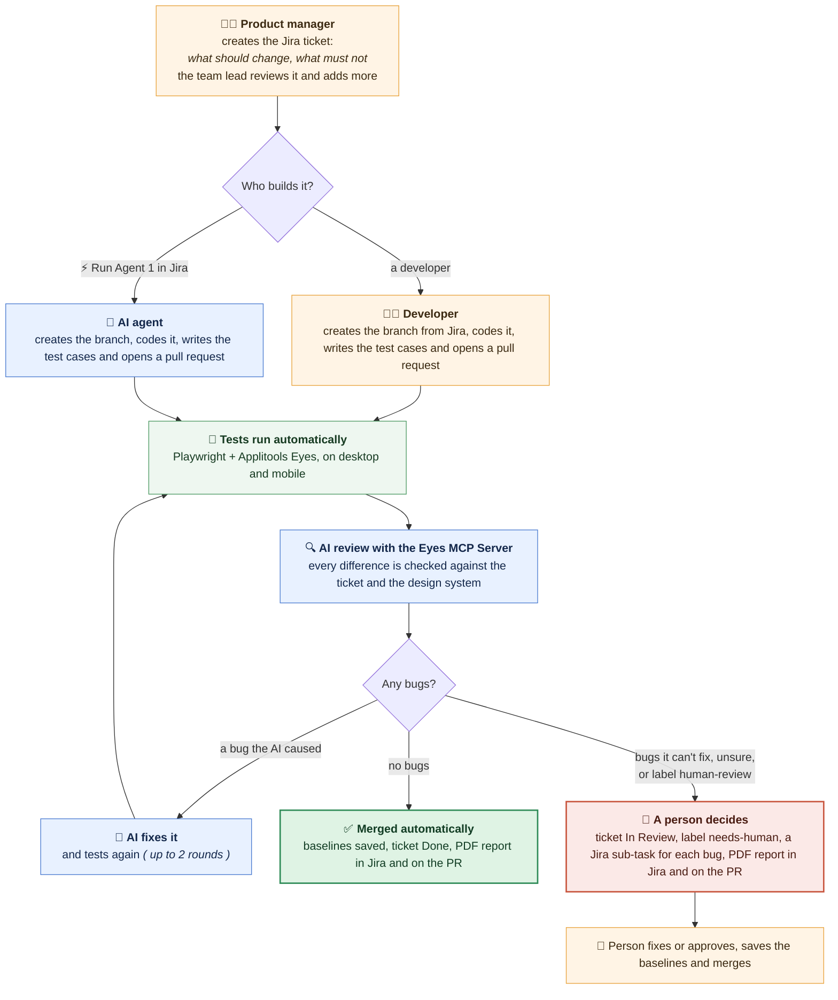

# From Jira ticket to merged pull request, reviewed by AI

A product manager writes a Jira ticket. A developer, or the AI, builds it. Playwright and Applitools Eyes test it, and an AI reviews every visual change with the Applitools Eyes MCP. If no bugs are found, it is merged automatically. Otherwise, a person decides.

## How it works

1. Jira ticket: the product manager creates the task in Jira with what should change and what must not change. The team lead can review the task and add more details.
2. Implementation: a developer [ or ] the AI agent builds the change.
3. Test cases: the AI agent creates the test cases ( functional and visual ) and runs them. When a developer builds it, the developer adds the test cases. Applitools Eyes visually tests every screen on desktop and mobile.
4. AI review: once the results are there, the AI reviews them using the Eyes MCP Server. Every difference is checked against the ticket and the design system.
5. Acceptance:
   - With the `human-review` label: the AI gives its review, and a person approves before anything is saved or merged.
   - Without the `human-review` label: the AI automatically accepts or rejects each change based on the available information ( the ticket, the design system, the image and DOM differences ).
6. Auto fix: if the change causes an issue, the AI fixes it and tests again ( up to 2 rounds ). If it cannot fix a bug, it creates a sub-task for it in Jira.
7. Report: a PDF summary report of the actions it took is attached to the Jira ticket and linked on the pull request.
8. Merge: if no bugs are found, it is merged automatically. Otherwise, a person decides.

## Jira status: who is involved when

The Jira ticket moves through four statuses. The pipeline moves it automatically, so the status always shows where the work is and who has it.

| Jira status | What happens | AI agent path | Developer path |
|---|---|---|---|
| To Do | The product manager creates the ticket. The team lead reviews it and adds more details. | People only | People only |
| In Progress | The change is being built and tested. | Someone clicks ⚡ Run Agent 1, and the ticket moves to In Progress automatically. The AI creates the branch, builds the change, writes and runs the test cases, reviews the results with the Eyes MCP Server, and fixes its own bugs. | The developer moves the ticket to In Progress ( or Jira does it when the branch is created, see note ), builds the change, writes the test cases and opens a pull request. The AI then reviews the pull request. |
| In Review | A person needs to decide: bugs the AI could not fix, unclear changes, failed functional checks, or the `human-review` label. The ticket gets the label `needs-human` and is assigned to the person who created it. | A person reads the PDF report and fixes or approves. | The developer reads the PDF report and pushes a fix. The AI reviews again. |
| Done | The pull request is merged. The baselines in Eyes are updated. | Automatic when there are no bugs | Automatic when the AI review passes ( or after a person merges ) |

*Who is involved, in order*

- AI agent path: product manager and team lead ( To Do ) → anyone clicks Run Agent 1 → AI agent ( In Progress ) → a person only if needed ( In Review ) → Done.
- Developer path: product manager and team lead ( To Do ) → developer ( In Progress ) → AI review on the pull request → developer again only if the AI found bugs ( In Review ) → AI review again → Done.

Note: to move the ticket to In Progress automatically when a developer creates a branch, add a Jira Automation rule: trigger "Branch created", action "Transition work item to In Progress".

## Documents

All the documents are in the [`docs/`](docs/) folder. Please read them in this order:

1. [FLOW.md](docs/FLOW.md): how it works, step by step, and which files are involved in each step.
2. [PROJECT_STRUCTURE.md](docs/PROJECT_STRUCTURE.md): what each folder does, why it is important, and what to keep, adapt or replace for your own project.
3. [INSTALLATION.md](docs/INSTALLATION.md): how to set it up in your own project, with screenshots.

## Who is it for (user journey)

*The problem today*

- Developers change a component and nobody tells the design team. Often the only trace is a Slack message between a designer and a developer.
- The QA team finds these differences late, by comparing the product with the design by hand, and then starts a discussion with the developer or the product team.
- Every UI change needs someone to open the visual test results and decide, one by one, if each difference was intended.

*How each person uses this flow*

- Product manager / team lead: creates the Jira ticket with what should change and what must not change. Gets a PDF report in the ticket, without chasing anyone for the status.
- Developer: creates the branch from the ticket, or lets the AI agent build it. Gets the review in the pull request within minutes, before the change reaches QA.
- QA team: no longer compares every screen by hand. The AI does the first review, and QA looks only at what was flagged: bugs, design rule breaks and unclear changes. The PDF ( differences classified by severity, with evidence ) becomes the starting point for the discussion with design and development.
- Design team: the design system is written once in `guidelines/design-system.md`, and every pull request is checked against it. An undocumented change to a component is caught in the build, not in production.
- Engineering manager: sees in the trust report how often people agree with the AI, before deciding how much to automate.

*Example*

The PM creates WIKI-18: "Change the portal tagline to The Free Encyclopedia for everyone". Someone clicks Run Agent 1 in Jira. About 10 minutes later the change is implemented, tested on desktop and mobile, reviewed by the AI ( 2 real changes, 0 bugs ), merged, and the ticket is Done with the PDF attached. No one had to compare a screenshot.

*Coming next*

Comparing the implementation directly with the Figma design ( Eyes MCP Server + Figma MCP ), so that a build which doesn't match the design fails before it reaches QA.

## The flow



Colours: orange = a person, blue = the AI agent, green = automatic. The same diagram as an image, for slides or a blog: [docs/images/user-flow.png](docs/images/user-flow.png).

### Step 1: Connect Jira and GitHub (once)

A Jira admin installs **GitHub for Atlassian** and picks which repositories Jira can see, such as `wikipedia-visual-ci`.

Each product gets its own Jira project with a short key, for example **WIKI**. Tickets are then numbered WIKI-1, WIKI-2, and so on. That key is how Jira and GitHub find each other.

### Step 2: Write the ticket

The PM or team lead writes a Jira ticket with two lists: **what should change** and **what must not change**.

- It's a feature by default. Add the label `bug` or `hotfix` if it's one of those.
- Add the label `human-review` if a person must approve before anything is merged.
- The PM decides who builds it: a developer or the AI agent.

### Step 3: Create a branch

Put the ticket key in the branch name, for example `feature/WIKI-17-make-donate-bold`. You can create it in two ways:

- **In Jira:** open the ticket and click **Development → Create branch**.
- **In git:** create the branch yourself and push it.

Either way, the branch is linked to the ticket, and a copy of the ticket is added to the branch as `tasks/WIKI-17-….md`.

### Step 4: Build it and write the tests

- **A developer** makes the change, adds or updates the Playwright tests, and opens a pull request.
- **Or the AI:** anyone clicks ⚡ **Run Agent 1** in Jira. The AI makes the change, writes the tests (plus a regression test for a bug), runs them, and opens the pull request. If there's no branch yet, it creates one.

The tests check both behaviour (Playwright) and appearance (Applitools Eyes).

### Step 5: Tests run automatically

When the pull request opens, GitHub Actions starts the site and runs the tests. Applitools Eyes captures every important screen on Chrome desktop and a Galaxy S25 Ultra phone in a single run.

Each screen is compared with the **branch the pull request will merge into** (usually `main`). Every branch keeps its own baselines in Eyes, so branches never overwrite each other, and `main` only changes when code is merged.

### Step 6: The AI reviews every difference

Using the Applitools Eyes MCP, the AI goes through every difference Eyes found and checks it against the ticket and the design system:

- **Asked for by the ticket** → accepted.
- **Not asked for, or breaks the design system** → rejected as a bug, with evidence and a suggested fix.
- **Not sure** → left for a person.

If the AI wrote the code, it fixes its own bugs and runs the tests again (up to 2 times).

### Step 7: A report goes to Jira

A PDF is attached to the Jira ticket. It shows a summary, before and after images, and each bug with why it's a bug and how to fix it. A comment on the ticket links to the PDF and the pull request. If the AI did the work, each bug it couldn't fix also becomes a Jira sub-task.

### Step 8: Merge, or ask a person

- **No bugs left:** the baselines are saved, the pull request is merged, and the ticket moves to Done. Nobody has to do anything.
- **Bugs the AI couldn't fix, or a `human-review` label:** a person reads the PDF, fixes or approves the change, then saves the baselines and merges.

## What's where

| Path | What it is |
| --- | --- |
| `site/` | The demo Wikipedia site |
| `tests/` | Playwright + Eyes tests |
| `docs/` | The documents: how it works, project structure, installation guide |
| `guidelines/` | The rules the AI follows: plain text, edit to change its behaviour |
| `.github/workflows/` | The pipeline |
| `scripts/` | Helpers: Jira, Eyes, the PDF report |

## Setup

For the full step-by-step setup in your own project ( with screenshots ), see [docs/INSTALLATION.md](docs/INSTALLATION.md).

1. Install **GitHub for Atlassian** in Jira and connect this repository.
2. Add these repository secrets: `APPLITOOLS_API_KEY`, `APPLITOOLS_READ_KEY`, `APPLITOOLS_WRITE_KEY`, `CLAUDE_CODE_OAUTH_TOKEN` (or `ANTHROPIC_API_KEY`), `JIRA_BASE_URL`, `JIRA_EMAIL`, `JIRA_API_TOKEN`.
3. Optional: a Jira Automation rule for the **Run Agent 1** button, calling this repo's `implement-task.yml` workflow with the ticket key.

## Run locally

```bash
npm ci && npx playwright install chromium
npm start              # http://localhost:3001/wikipedia
npx playwright test    # in a second terminal
```

## Why trust an AI reviewer?

An AI model is probabilistic: left alone, it might skim or stop early. The Applitools Eyes MCP adds **deterministic guardrails for probabilistic code**:

- **No shortcuts**: the MCP walks the AI through every changed area, and the review isn't finished until every difference has been looked at.
- **Each decision from its own evidence**: every step is accepted, rejected or left unresolved based on its own image diff, DOM change and the ticket.
- **Nothing is final until saved**: accepts and rejects can be undone; saving is a separate step the AI never takes.

## Safety

The AI can accept or reject changes in Eyes, but it can never save baselines, push or merge: the pipeline does that, and only when there are no bugs. It can change only `site/` and `tests/`.

`main` is protected: every change goes through a pull request, and two checks must pass before anyone can merge: **Branch links to a Jira ticket** and **Visual review** (the AI review, functional checks included). The AI works as its own GitHub account, `eyes-mcp-visual-agent[bot]`, so everything it does is visible and checked like a developer's.

Want a person to approve every change too? Run `scripts/set-merge-policy.sh code-approval` (back with `auto`). How often people agree with the AI: **Actions → Trust report**.

This is a demo that merges straight into `main`. Adapt it to your branches (staging, QA, release) and add a human code approval as your team needs.
