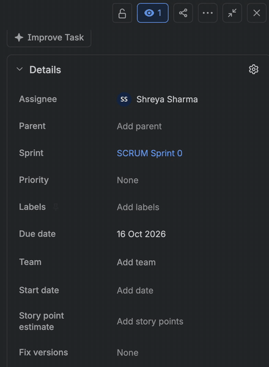
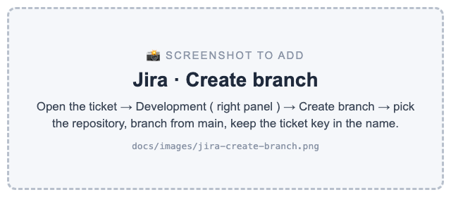
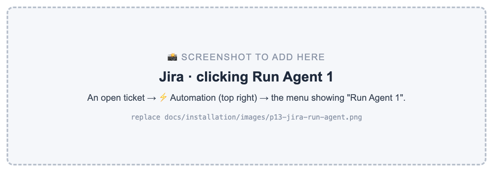
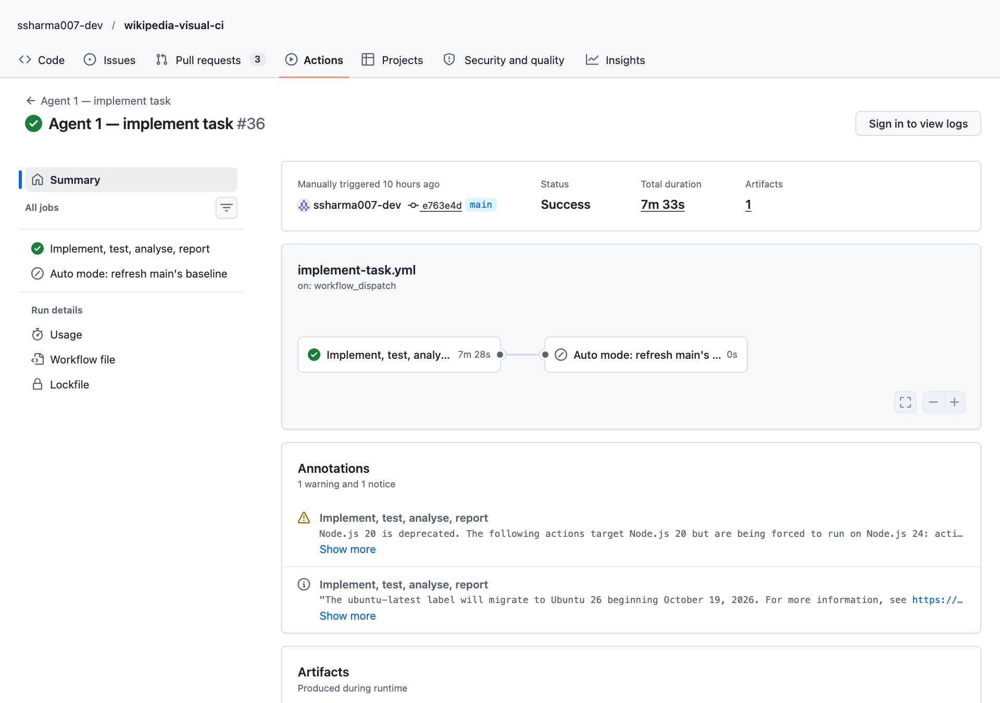
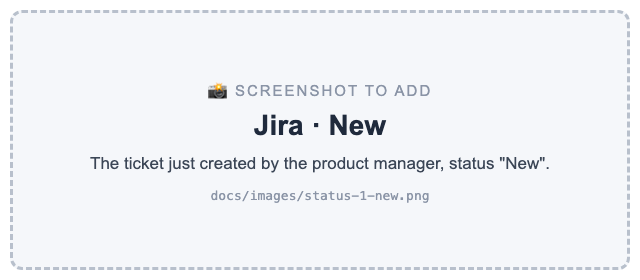
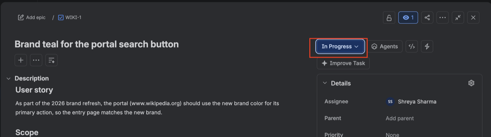
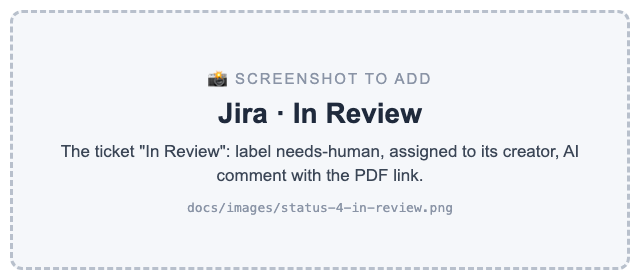
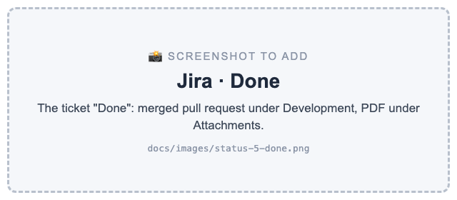
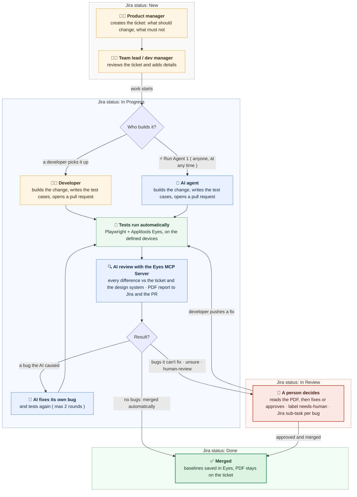

# From Jira ticket to merged pull request, reviewed by AI

A product manager creates a Jira ticket, and the team lead or dev manager reviews it and adds the details. A developer picks it up, or anyone clicks ⚡ Run Agent 1 in Jira ( at any time before the ticket is Done ) and the AI agent builds it. Playwright and Applitools Eyes test the change on the devices listed in the ticket ( or the defaults in `playwright.config.ts` ), and the AI reviews every visual difference against the ticket and the design system using the Applitools Eyes MCP Server.

If no bugs are found, the change is merged automatically and the ticket moves to Done, with a PDF report attached. If the AI caused a bug, it fixes it and tests again. If there are bugs it cannot fix, or the ticket has the `human-review` label, the ticket moves to In Review and a person decides.

The goal: QA and developers no longer compare screenshots by hand. People only step in when a decision is really needed.

## How it works

1. Create the ticket ( Jira status: New ): the product manager creates the ticket in Jira with what should change and what must not change.
2. Review the ticket ( Jira status: New ): while the ticket is still New, the team lead or dev manager reviews it and adds more details. It moves to In Progress when the work starts. Optional labels: `feature`, `bug`, `hotfix`, `text`, `human-review` ( no label = feature ). To add a label: open the ticket → Details panel on the right → Labels → type the label → Enter.

   

   Jira only lists labels that are already used on a ticket. The first time, type the new label ( e.g. `human-review` ) and press Enter to create it; after that it appears in the list.
3. Build the change ( Jira status: In Progress ): a developer picks it up [ or ] anyone ( dev manager, team lead, developer ) clicks ⚡ Run Agent 1 in Jira and the AI agent builds it. Run Agent 1 can be clicked at any time before Done. If a developer has already started, the AI continues on the same branch ( see "Run Agent 1 at each status" below ).

   | (1) A developer: Development → Create branch | (2) The AI agent: ⚡ Automation → Run Agent 1 | The AI agent at work in GitHub Actions |
   |---|---|---|
   |  |  |  |
4. Test cases ( Jira status: In Progress ):
   - AI agent: creates the test cases ( functional and visual ), using the Applitools Eyes MCP Server to add the visual checkpoints, and runs them.
   - Developer: writes their own test cases, [ or ] clicks ⚡ Run Agent 1 and the AI adds them. The AI continues on the developer's branch, so it also completes anything still missing from the ticket.
   - Applitools Eyes visually tests every screen, component or important area that the Jira ticket names: the full page, or only a component ( e.g. the header links ) when the change is local. It runs on the devices listed in the ticket under "Test on below devices", or, if the ticket lists none, on the defaults in `playwright.config.ts` ( here Chrome desktop and Galaxy S25 Ultra ).
5. AI review ( Jira status: In Progress ): once the results are there, the AI reviews them using the Eyes MCP Server. Every difference is checked against the ticket and the design system.
6. Acceptance ( Jira status: In Progress ):
   - Without the `human-review` label: the AI automatically accepts or rejects each change based on the available information ( the ticket, the design system, the image and DOM differences ).
   - With the `human-review` label: the AI gives its review, and a person approves before anything is saved or merged.
7. Auto fix ( Jira status: In Progress ): if the AI's change causes an issue, the AI fixes it and tests again ( up to 2 rounds ). For every bug it fixed, it creates a Jira sub-task in Done status with the details: what the issue was, why it was a bug, what it fixed and how. If it cannot fix a bug, it creates an open sub-task for a person.
8. Report ( Jira status: In Progress ): after each execution, a PDF summary report is attached to the Jira ticket and linked on the pull request. It shows the results at a glance ( test cases run, passed and failed, visual checkpoints with and without differences, differences accepted or rejected by the AI, bugs found, fixed and left ), the actions the AI took, and the before / after / difference images for every change.
9. Decision ( Jira status: Done or In Review ):
   - No bugs found ( Jira status: Done ): the change is merged automatically and the baselines in Eyes are saved.
   - Bugs it cannot fix, unclear changes, or the `human-review` label ( Jira status: In Review ): the ticket gets the label `needs-human` and is assigned to the person who created it. A person reads the PDF and fixes or approves. When the developer pushes a fix, the AI reviews it again.

   Note: In Review means the work is waiting for a person's decision. It is not used for reviewing the ticket itself ( that happens while the ticket is New ).

## Jira status: who is involved when

The Jira ticket moves through four statuses: New → In Progress → In Review → Done. Anyone ( dev manager, team lead, developer ) can involve the AI agent at any time before Done by clicking ⚡ Automation → Run Agent 1 on the ticket. If a developer has already started, the AI continues on the same branch.

| Jira status | Who | What happens | Screenshot |
|---|---|---|---|
| New | Product manager, then team lead or dev manager | The product manager creates the ticket with what should change and what must not change. The team lead or dev manager reviews it and adds more details. |  |
| In Progress | Developer [ or ] AI agent | (1) Developer: moves the ticket to In Progress, builds the change, writes the test cases and opens a pull request. The AI then reviews the pull request. (2) AI agent: someone clicks Run Agent 1, the ticket moves to In Progress automatically, and the AI builds the change, writes and runs the test cases, reviews the results with the Eyes MCP Server and fixes its own bugs. |  |
| In Review | A person ( developer, team lead or dev manager ) | Only when a person needs to decide: bugs the AI could not fix, unclear changes, failed functional checks, or the `human-review` label. The ticket gets the label `needs-human`, is assigned to the person who created it, and has the PDF report attached. The developer fixes and pushes, and the AI reviews again. |  |
| Done | Pipeline ( automatic ) | The pull request is merged and the baselines in Eyes are updated. The PDF report stays attached to the ticket. |  |

*Who is involved, in order*

- AI agent path: product manager and team lead or dev manager ( New ) → anyone clicks Run Agent 1 → AI agent ( In Progress ) → a person only if needed ( In Review ) → Done.
- Developer path: product manager and team lead or dev manager ( New ) → developer ( In Progress ) → AI review on the pull request → developer again only if the AI found bugs ( In Review ) → AI review again → Done.

Note:
- The pipeline moves the ticket to In Progress ( AI path ), In Review and Done. New is the status of every new ticket.
- If your Jira uses other names ( e.g. "Doing" instead of "In Progress" ), the pipeline accepts "In Progress" or "Doing" by default. You can set your own names with the repository variables `JIRA_STATUS_IN_PROGRESS`, `JIRA_STATUS_IN_REVIEW` and `JIRA_STATUS_DONE`.
- To move the ticket to In Progress automatically when a developer creates a branch, add a Jira Automation rule: trigger "Branch created", action "Transition work item to In Progress".

*Run Agent 1 at each status ( current behaviour )*

| Jira status when clicked | What the AI agent does |
|---|---|
| New | Creates a new branch from `main`, builds the change, writes and runs the test cases, reviews them and opens the pull request. The ticket moves to In Progress. |
| In Progress ( a developer already started ) | Continues on the developer's branch: builds what is still missing according to the ticket, writes and runs the test cases, reviews everything and pushes to the same pull request. It works from the ticket and the current code. It does not know what the developer planned to do next. |
| In Review ( the review found bugs ) | Moves the ticket back to In Progress, continues on the same branch and reviews everything again. It may fix the bugs, because it checks the ticket and the design system again, but it does not read the previous review. |
| Done | Not useful: the branch was deleted when it was merged, so the AI starts again from `main` and finds nothing left to do. Tip: in the Jira rule, add the condition "Status is not Done". |

Good to know: when the AI continues on a developer's pull request and the review passes, the pipeline merges that pull request automatically, including the developer's code. Add the `human-review` label, or use `MERGE_POLICY=code-approval`, if a person should always approve.

*When the AI review runs ( current behaviour )*

- Automatically on every pull request: when it is opened and on every push to it ( developer path ).
- As part of Run Agent 1: the AI reviews its own work before it opens the pull request ( AI path ).
- On demand, from GitHub: Actions → Visual tests → Run workflow → enter the pull request number. There is no Jira button for a review only, yet.

## Writing a Jira ticket ( sample )

The AI builds and reviews the change based on what the ticket says, so a clear ticket gives a better result. Most important: the "Must not change" list. This is what the AI uses to tell a real change from a bug.

*Fields*

| Field | Required / Optional | What to write | Why it matters |
|---|---|---|---|
| Summary | Required | One line: what changes, where. e.g. "Make the Donate link bold in the article header" | Becomes the branch name and the PR title |
| Should change | Required | The changes you expect, one per line, with the page and the device if it matters | The AI accepts only these differences as real changes |
| Must not change | Required | What must stay exactly as it is ( other pages, other devices, nearby elements ) | Anything on this list that changes is reported as a bug |
| Why | Optional | The reason for the change | Helps the reviewer and the AI understand the intent |
| Pages / screens | Optional | Where the change is visible | Helps the AI find the relevant test cases |
| Test on below devices | Optional | e.g. "Galaxy S25 Ultra", "Chrome desktop 1200×800" | The devices Applitools Eyes tests this ticket on. Without it, the defaults in `playwright.config.ts` are used |
| Design reference | Optional | A design system rule or a Figma link | Checked together with `guidelines/design-system.md` |
| Steps to reproduce, Actual, Expected | Required for a bug or hotfix | How to see the bug, what you see now, what you should see | The AI first reproduces the bug, then fixes it and adds a regression test |
| Labels | Optional | `feature`, `bug`, `hotfix`, `text` ( a text-only change: the AI expects only text to change and checks the new text fits ), `human-review` ( extra types: `refactor` = no visual change expected, `a11y` = accessibility ) | Tells the AI the type of work ( no label = feature ). `human-review` means a person approves before the merge |
| Work type | Optional | Task ( default, treated as a feature ) or Bug | A Bug work type is treated like the `bug` label |

*Template ( copy into the Jira description )*

```
Why:
<optional: the reason for the change>

Should change:
- <change 1, with the page / device if it matters>
- <change 2>

Must not change:
- <what must stay exactly as it is>
- <other pages, other devices, nearby elements>

Pages / screens: <optional>

Test on below devices ( optional ):
- <e.g. Chrome desktop 1200×800>
- <e.g. Galaxy S25 Ultra>

Design reference: <optional: design system rule or Figma link>
```

Note: "Test on below devices" decides where Applitools Eyes tests this ticket. The pipeline reads the list and runs the tests on exactly these devices. Without the list, the defaults in `playwright.config.ts` are used ( here Chrome desktop 1200×800 and Galaxy S25 Ultra ). How to write a device:
- Desktop browser: `Chrome`, `Firefox`, `Safari` or `Edge`, with the size, e.g. `Chrome desktop 1200×800` ( default size 1200×800 ).
- iPhone or iPad: the device name, e.g. `iPhone 15`.
- Other phones and tablets: the device name, e.g. `Galaxy S25 Ultra`, `Pixel 7`.

The device names must be supported by the Applitools Ultrafast Grid ( see the Reference in [docs/INSTALLATION.md](docs/INSTALLATION.md) ).

*Sample 1: a text change*

```
Summary: Change the portal tagline to "The Free Encyclopedia for everyone"
Labels: text

Why:
Marketing wants the portal to feel more welcoming for first-time visitors.

Should change:
- On the Wikipedia portal page, the tagline under the Wikipedia wordmark reads
  "The Free Encyclopedia for everyone" instead of "The Free Encyclopedia".

Must not change:
- The wordmark, the language links around it and the search bar.
- Anything else on the portal page.
- The article pages.

Test on below devices:
- Chrome desktop 1200×800
- Galaxy S25 Ultra
```

*Sample 2: a bug*

```
Summary: Search button is cut off on phones
Work type: Bug ( or label: bug )

Steps to reproduce:
1. Open the Wikipedia portal on a phone ( e.g. Galaxy S25 Ultra ).
2. Look at the search bar.

Actual:
The Search button is cut off at the right edge of the screen.

Expected:
The whole Search button is visible, next to the search field.

Must not change:
- The search bar on desktop.
- The rest of the portal page.

Test on below devices:
- Galaxy S25 Ultra
- Chrome desktop 1200×800
```

Tip: add the label `human-review` when the change is sensitive ( e.g. checkout, legal text ) and a person must approve before the merge.

## Documents

All the documents are in the [`docs/`](docs/) folder. Please read them in this order:

1. [FLOW.md](docs/FLOW.md): how it works, step by step, and which files are involved in each step.
2. [PROJECT_STRUCTURE.md](docs/PROJECT_STRUCTURE.md): what each folder does, why it is important, and what to keep, adapt or replace for your own project.
3. [INSTALLATION.md](docs/INSTALLATION.md): how to set it up in your own project, with screenshots.

## Who is it for (user journey)

*The problem today*

- Developers change a component and nobody tells the design team. Often the only trace is a Slack message between a designer and a developer.
- The QA team finds these differences late, by comparing the product with the design by hand, and then starts a discussion with the developer or the product team.
- Every UI change needs someone to open the visual test results and decide, one by one, if each difference was intended.

*How each person uses this flow*

- Product manager / team lead: creates the Jira ticket with what should change and what must not change. Gets a PDF report in the ticket, without chasing anyone for the status.
- Developer: creates the branch from the ticket, or lets the AI agent build it. Gets the review in the pull request within minutes, before the change reaches QA.
- QA team: no longer compares every screen by hand. The AI does the first review, and QA looks only at what was flagged: bugs, design rule breaks and unclear changes. The PDF ( differences classified by severity, with evidence ) becomes the starting point for the discussion with design and development.
- Design team: the design system is written once in `guidelines/design-system.md`, and every pull request is checked against it. An undocumented change to a component is caught in the build, not in production.
- Engineering manager: sees in the trust report how often people agree with the AI, before deciding how much to automate.

*Example*

The PM creates WIKI-21: "Rename Free learning resources to Free learning materials on the portal", label `text`, with "Test on below devices: Firefox desktop 1280×800, Galaxy S25 Ultra". Someone clicks Run Agent 1 in Jira. About 9 minutes later the change is implemented, tested on exactly those two devices ( 8 test cases passed, 12 visual differences accepted, 0 bugs ), merged, and the ticket is Done with the PDF attached. No one had to compare a screenshot.

*Coming next*

Comparing the implementation directly with the Figma design ( Eyes MCP Server + Figma MCP ), so that a build which doesn't match the design fails before it reaches QA.

## The flow



How to read it: each grey or coloured band is a Jira status ( New → In Progress → In Review → Done ), so you can see where the ticket is and who has it. Orange = a person, blue = the AI agent, green = automatic. The same diagram as an image, for slides or a blog: [user-flow.png](docs/images/user-flow.png).

### Step 1: Connect Jira and GitHub (once)

A Jira admin installs **GitHub for Atlassian** and picks which repositories Jira can see, such as `wikipedia-visual-ci`.

Each product gets its own Jira project with a short key, for example **WIKI**. Tickets are then numbered WIKI-1, WIKI-2, and so on. That key is how Jira and GitHub find each other.

### Step 2: Write the ticket

The PM or team lead writes a Jira ticket with two lists: **what should change** and **what must not change**.

- It's a feature by default. Add the label `bug` or `hotfix` if it's one of those.
- Add the label `human-review` if a person must approve before anything is merged.
- The PM decides who builds it: a developer or the AI agent.

### Step 3: Create a branch

Put the ticket key in the branch name, for example `feature/WIKI-17-make-donate-bold`. You can create it in two ways:

- **In Jira:** open the ticket and click **Development → Create branch**.
- **In git:** create the branch yourself and push it.

Either way, the branch is linked to the ticket, and a copy of the ticket is added to the branch as `tasks/WIKI-17-….md`.

### Step 4: Build it and write the tests

- **A developer** makes the change, adds or updates the Playwright tests, and opens a pull request.
- **Or the AI:** anyone clicks ⚡ **Run Agent 1** in Jira. The AI makes the change, writes the tests (plus a regression test for a bug), runs them, and opens the pull request. If there's no branch yet, it creates one.

The tests check both behaviour (Playwright) and appearance (Applitools Eyes).

### Step 5: Tests run automatically

When the pull request opens, GitHub Actions starts the site and runs the tests. Applitools Eyes captures every important screen on Chrome desktop and a Galaxy S25 Ultra phone in a single run.

Each screen is compared with the **branch the pull request will merge into** (usually `main`). Every branch keeps its own baselines in Eyes, so branches never overwrite each other, and `main` only changes when code is merged.

### Step 6: The AI reviews every difference

Using the Applitools Eyes MCP, the AI goes through every difference Eyes found and checks it against the ticket and the design system:

- **Asked for by the ticket** → accepted.
- **Not asked for, or breaks the design system** → rejected as a bug, with evidence and a suggested fix.
- **Not sure** → left for a person.

If the AI wrote the code, it fixes its own bugs and runs the tests again (up to 2 times).

### Step 7: A report goes to Jira

A PDF is attached to the Jira ticket. It shows a summary, before and after images, and each bug with why it's a bug and how to fix it. A comment on the ticket links to the PDF and the pull request. If the AI did the work, each bug it couldn't fix also becomes a Jira sub-task.

### Step 8: Merge, or ask a person

- **No bugs left:** the baselines are saved, the pull request is merged, and the ticket moves to Done. Nobody has to do anything.
- **Bugs the AI couldn't fix, or a `human-review` label:** a person reads the PDF, fixes or approves the change, then saves the baselines and merges.

## What's where

| Path | What it is |
| --- | --- |
| `site/` | The demo Wikipedia site |
| `tests/` | Playwright + Eyes tests |
| `docs/` | The documents: how it works, project structure, installation guide |
| `guidelines/` | The rules the AI follows: plain text, edit to change its behaviour |
| `.github/workflows/` | The pipeline |
| `scripts/` | Helpers: Jira, Eyes, the PDF report |

## Setup

For the full step-by-step setup in your own project ( with screenshots ), see [docs/INSTALLATION.md](docs/INSTALLATION.md).

1. Install **GitHub for Atlassian** in Jira and connect this repository.
2. Jira workflow ( must do ): four statuses New → In Progress → In Review → Done, and the START arrow pointing to **New**, so every new ticket starts in New. See step 6.2 in [docs/INSTALLATION.md](docs/INSTALLATION.md).
3. Jira board ( must do ): every ticket must be visible on the board. For this demo, sprints and the backlog are turned off ( Space settings → Features → Sprints off, and More items → Backlog off ), so the board shows every ticket by status. If your team uses sprints, add a Jira Automation rule "Work item created → Sprint = Active sprint" instead. See step 6.2b in [docs/INSTALLATION.md](docs/INSTALLATION.md).
4. Add these repository secrets: `APPLITOOLS_API_KEY`, `APPLITOOLS_READ_KEY`, `APPLITOOLS_WRITE_KEY`, `CLAUDE_CODE_OAUTH_TOKEN` (or `ANTHROPIC_API_KEY`), `JIRA_BASE_URL`, `JIRA_EMAIL`, `JIRA_API_TOKEN`.
5. Optional: a Jira Automation rule for the **Run Agent 1** button, calling this repo's `implement-task.yml` workflow with the ticket key.

## Run locally

```bash
npm ci && npx playwright install chromium
npm start              # http://localhost:3001/wikipedia
npx playwright test    # in a second terminal
```

## Why trust an AI reviewer?

An AI model is probabilistic: left alone, it might skim or stop early. The Applitools Eyes MCP adds **deterministic guardrails for probabilistic code**:

- **No shortcuts**: the MCP walks the AI through every changed area, and the review isn't finished until every difference has been looked at.
- **Each decision from its own evidence**: every step is accepted, rejected or left unresolved based on its own image diff, DOM change and the ticket.
- **Nothing is final until saved**: accepts and rejects can be undone; saving is a separate step the AI never takes.

## Safety

The AI can accept or reject changes in Eyes, but it can never save baselines, push or merge: the pipeline does that, and only when there are no bugs. It can change only `site/` and `tests/`.

`main` is protected: every change goes through a pull request, and two checks must pass before anyone can merge: **Branch links to a Jira ticket** and **Visual review** (the AI review, functional checks included). The AI works as its own GitHub account, `eyes-mcp-visual-agent[bot]`, so everything it does is visible and checked like a developer's.

Want a person to approve every change too? Run `scripts/set-merge-policy.sh code-approval` (back with `auto`). How often people agree with the AI: **Actions → Trust report**.

This is a demo that merges straight into `main`. Adapt it to your branches (staging, QA, release) and add a human code approval as your team needs.
