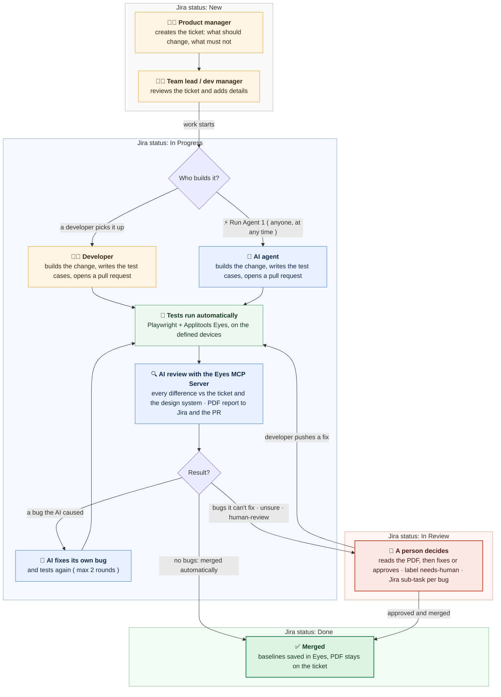

# How it works (flow)

This document explains how the pieces of this project work together, from the Jira ticket to the merged pull request. For each step it shows what happens, who or what does it, and which files are involved.

For what each folder contains, see [PROJECT_STRUCTURE.md](PROJECT_STRUCTURE.md). For the setup, see [INSTALLATION.md](INSTALLATION.md).

---

## The pieces

- Jira: where the PM or team lead creates the ticket, and where the PDF report and the status updates land.
- GitHub for Atlassian: links branches, commits and pull requests to the Jira ticket, using the ticket key ( e.g. WIKI-18 ) in their names.
- GitHub Actions: runs the workflows in `.github/workflows/`. This is the pipeline.
- AI agent: Claude Code, running inside GitHub Actions. It works as its own GitHub account, `eyes-mcp-visual-agent[bot]`.
- Playwright: runs the test cases in `tests/` ( functional checks ).
- Applitools Eyes and the Ultrafast Grid: capture every screen on Chrome desktop and Galaxy S25 Ultra and compare it with the baseline ( visual checks ).
- Applitools Eyes MCP Server: gives the AI access to the Eyes results, and makes it go through every difference one by one ( deterministic guardrails ).
- Guidelines: the plain text rules in `guidelines/` that the AI follows.

---

## The flow at a glance

How to read it: each grey or coloured band is a Jira status ( New → In Progress → In Review → Done ), so you can see where the ticket is and who has it. Orange = a person, blue = the AI agent, green = automatic. The same diagram as an image, for slides or a blog: [user-flow.png](images/user-flow.png).

---

## Step 1: The ticket is created

What happens: the PM or team lead creates a ticket in Jira with two lists, what should change and what must not change. Optional labels: `bug`, `hotfix` ( changes how strict the AI is ) and `human-review` ( a person must approve before the merge ).

Who: PM or team lead.

Files: none. The ticket lives in Jira.

---

## Step 2: The branch is created and linked

What happens: a branch is created with the ticket key in its name, (1) from Jira with Development → Create branch, [ or ] (2) in git. GitHub for Atlassian links it to the ticket. The pipeline copies the ticket into the branch as `tasks/WIKI-18-….md`, so the task travels with the code.

Who: the developer, or the AI agent ( it creates the branch itself if there is none ).

Files:
- `.github/workflows/sync-task-on-branch.yml`: copies the ticket when a developer creates the branch.
- `.github/workflows/implement-task.yml`: does the same when the AI creates the branch.
- `scripts/jira.mjs`: reads the ticket from Jira.

---

## Step 3: The change is implemented

What happens:
- (1) A developer implements the change, adds or updates the test cases, and opens a pull request.
- (2) Someone clicks ⚡ Run Agent 1 in Jira. A Jira Automation rule calls GitHub, which starts Agent 1. The AI reads the ticket and the guidelines, implements the change, writes the test cases ( and a regression test for a bug ) using the Eyes MCP Server to add the visual checkpoints, and runs them. The ticket moves to In Progress.
- A developer can also write their own code and let the AI write the test cases: click Run Agent 1 on the ticket, and the AI continues on the developer's branch.

Who: developer [ or ] AI agent.

If Run Agent 1 is clicked when a branch already exists ( a developer started, or an earlier AI run ), the AI continues on that branch and pushes to the same pull request. It works from the ticket and the current code; it does not read the previous review. See "Run Agent 1 at each status" in the [README](../README.md).

Files:
- `.github/workflows/implement-task.yml`: the whole Agent 1 run.
- `guidelines/agent-implement.md`: the AI's instructions.
- `.mcp.json`: connects the AI to the Eyes MCP Server.
- Repository variable `AGENT_ALLOWED_PATHS`: the only folders the AI may change. Anything else is thrown away.

---

## Step 4: The tests run

What happens: GitHub Actions starts the app ( `APP_START_COMMAND`, `APP_URL` ) and runs the Playwright test cases. Each `eyes.check()` sends the screen to Applitools Eyes, and the Ultrafast Grid renders it on every browser and device in `playwright.config.ts`. Each screen is compared with the baseline of the branch the PR merges into ( Eyes branching ), usually `main`.

Who: GitHub Actions, Playwright, Applitools Eyes.

Files:
- `.github/workflows/visual-tests.yml`: runs on every pull request.
- `playwright.config.ts`: browsers, devices, Eyes branching, `failTestsOnDiff: false` ( the AI decides, not Playwright ).
- `tests/`: the test cases.
- `scripts/failed-tests.mjs`: lists failed functional checks. They don't stop the review, but the PR can't be merged until they pass.

---

## Step 5: The AI reviews every difference

What happens: through the Eyes MCP Server, the AI goes through every difference Eyes found, one by one. For each one it checks the image difference, the DOM change and the ticket:
- Asked for by the ticket and follows the design system: accepted in Eyes.
- Not asked for, or breaks the design system: rejected in Eyes as a bug, with evidence and a suggested fix.
- Not sure: left unresolved for a person.

On the AI path, if the AI caused a bug itself, it fixes the code, runs the tests again and reviews again, up to 2 rounds. On a developer's PR, the AI only reports bugs. It never changes a developer's code.

The AI can accept and reject in Eyes, but it can never save baselines.

Who: AI agent with the Eyes MCP Server.

Files:
- `guidelines/review-rules.md`: the classes and thresholds ( e.g. 2px or less is noise ).
- `guidelines/design-system.md`: the design rules every page must follow.
- `guidelines/agent-fix.md`: how the AI fixes its own bugs.

---

## Step 6: The report is created

What happens: the pipeline collects the before / after / differences images from Eyes, builds the PDF report, attaches it to the Jira ticket, comments on the ticket, and posts the PDF link on the PR. On the AI path, each bug the AI couldn't fix also becomes a Jira sub-task.

Who: the pipeline.

Files:
- `scripts/eyes-evidence.mjs`: images from Eyes.
- `scripts/render-report.mjs` and `scripts/report-pdf.mjs`: the HTML and PDF report.
- `scripts/jira.mjs`: attachment, comment, sub-tasks.

---

## Step 7: The checks on the pull request

What happens: two checks must pass before anyone can merge.
- Branch links to a Jira ticket: the branch name has a key, and the ticket exists in Jira. If not, the PR is blocked with a comment on how to rename the branch.
- Visual review: the AI review passed, the functional checks passed, and there is a ticket.

Who: GitHub ( rules on `main` ).

Files:
- `.github/workflows/ticket-check.yml`
- `.github/workflows/visual-tests.yml` and `implement-task.yml`: post the Visual review result.

---

## Step 8: Decide and merge

What happens:
- No bugs found: the pipeline saves the baselines in Eyes, merges the PR and moves the ticket to Done. No manual effort is needed.
- Bugs the AI can't fix, unclear changes, or the `human-review` label: the PR and the ticket get the label `needs-human`, the ticket moves to In Review and is assigned to the person who created it. A person reads the PDF, then fixes or approves, saves the baselines and merges.
- Optional: with `MERGE_POLICY=code-approval`, a passing PR also waits for one person's code approval, then GitHub merges it automatically.

After every merge to `main`, automatic or by a person, the pipeline updates `main`'s baseline in Eyes, moves the ticket to Done and removes the ticket copy from `main`.

Who: the pipeline, or a person.

Files:
- `scripts/eyes-save.mjs`: saves the baselines, only when nothing is unresolved.
- `scripts/set-merge-policy.sh`: switches between `auto` and `code-approval`.
- `.github/workflows/visual-tests.yml`: the after-merge update on `main`.
- `.github/workflows/clean-task-snapshots.yml`: removes `tasks/` from `main`.

---

## Jira status along the way

| Status | Set by | When |
|---|---|---|
| New | Product manager | The ticket is created; the team lead or dev manager reviews it and adds details |
| In Progress | Agent 1 ( AI path ), or the developer / a Jira Automation rule on "Branch created" ( developer path ) | The work starts. Anyone can click Run Agent 1 at any time before Done to involve the AI; on an existing branch it continues the work |
| In Review | The pipeline | The work is waiting for a person's decision ( label `needs-human`, assigned to the person who created the ticket ). Not used for reviewing the ticket itself |
| Done | The pipeline | The pull request is merged |

Status names can be changed with the repository variables `JIRA_STATUS_IN_PROGRESS`, `JIRA_STATUS_IN_REVIEW` and `JIRA_STATUS_DONE`.

---

## Who decides what

| | AI agent | Pipeline | Person |
|---|---|---|---|
| Implement the ticket | yes ( AI path ) | | yes ( developer path ) |
| Accept or reject a difference in Eyes | yes | | yes |
| Fix a bug it caused | yes ( up to 2 rounds ) | | |
| Save baselines in Eyes | never | yes, only when there are no bugs and nothing unresolved | yes |
| Merge the PR | never | yes, only when the checks pass | yes |
| Change the rules ( `guidelines/` ) | never | | yes, with CODEOWNERS approval |

---

## Over time: the trust report

Every Monday ( or on demand: Actions → Trust report ) the pipeline compares each AI verdict with what people did afterwards: merged, fixed, or overridden. This shows how often people agree with the AI, and where the rules in `guidelines/` need tuning.

Files: `.github/workflows/trust-report.yml`, `scripts/trust-report.mjs`.
