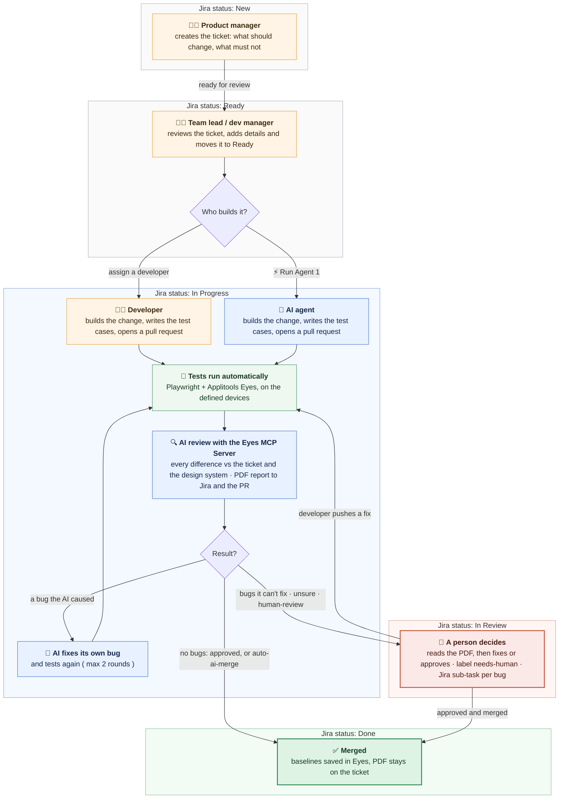

# How it works (flow)

This document explains how the pieces of this project work together, from the Jira ticket to the merged pull request. It follows the same 9 steps as "How it works" in the [README](../README.md). For each step it shows what happens, who or what does it, and which files are involved.

For what each folder contains, see [PROJECT_STRUCTURE.md](PROJECT_STRUCTURE.md). For the setup, see [INSTALLATION.md](INSTALLATION.md).

---

## The pieces

- Jira: where the product manager creates the ticket, the team lead or dev manager reviews it, and where the PDF report and the status updates land.
- GitHub for Atlassian: links branches, commits and pull requests to the Jira ticket, using the ticket key ( e.g. WIKI-21 ) in their names.
- GitHub Actions: runs the workflows in `.github/workflows/`. This is the pipeline.
- AI agent: Claude Code in this demo ( any coding agent that can use an MCP server works ), running inside GitHub Actions. It works as its own GitHub account, `eyes-mcp-visual-agent[bot]`.
- Playwright: runs the test cases in `examples/wikipedia/tests/` ( functional checks ).
- Applitools Eyes and the Ultrafast Grid: capture every screen on the devices listed in the ticket ( or the defaults ) and compare it with the baseline ( visual checks ).
- Applitools Eyes MCP Server: gives the AI access to the Eyes results, and makes it go through every difference one by one ( deterministic guardrails ).
- Guidelines: the plain text rules in `visual-agent/guidelines/` that the AI follows.

---

## The flow at a glance

How to read it: each grey or coloured band is a Jira status ( New → Ready → In Progress → In Review → Done ), so you can see where the ticket is and who has it. Orange = a person, blue = the AI agent, green = automatic. The same diagram as an image, for slides or a blog: [user-flow.png](images/user-flow.png).

---

## Step 1: Create the ticket ( Jira status: New )

What happens: the product manager creates the ticket in Jira, from the board's New column, with what should change and what must not change. Optionally, the devices to test on ( "Test on below devices" ).

Who: product manager.

Files: none. The ticket lives in Jira.

---

## Step 2: Review the ticket ( Jira status: Ready )

What happens: the team lead or dev manager reviews the New ticket, adds more details and moves it to Ready. Optional labels: `feature`, `bug`, `hotfix`, `text`, `human-review` ( a person approves before anything is saved or merged ), `auto-ai-merge` ( merge without waiting for a person's approval ). In Ready, they choose who builds it: assign a developer [ or ] click ⚡ Run Agent 1 for the AI agent.

Who: team lead or dev manager.

Files: none. The ticket lives in Jira.

---

## Step 3: Build the change ( Jira status: In Progress )

What happens:
- (1) Developer: the developer moves the ticket to In Progress, creates a branch from the ticket ( Development → Create branch ) [ or ] in git, with the ticket key in its name, builds the change and opens a pull request. GitHub for Atlassian links the branch to the ticket, and the pipeline copies the ticket into the branch as `tasks/WIKI-18-….md`, so the task travels with the code.
- (2) AI agent: someone clicks ⚡ ( Automation ) → Agent 1 on the ticket. A Jira Automation rule calls GitHub, which starts Agent 1. The ticket moves to In Progress, and the AI creates the branch itself, reads the ticket and the guidelines, and builds the change.

If Run Agent 1 is clicked when a branch already exists ( a developer started, or an earlier AI run ), the AI continues on that branch and pushes to the same pull request. See "Run Agent 1 at each status" in the [README](../README.md).

Who: developer [ or ] AI agent.

Files:
- `.github/workflows/implement-task.yml`: the whole Agent 1 run.
- `.github/workflows/sync-task-on-branch.yml`: copies the ticket when a developer creates the branch.
- `visual-agent/scripts/jira.mjs`: reads the ticket from Jira.
- `visual-agent/guidelines/agent-implement.md`: the AI's instructions.
- Repository variable `AGENT_ALLOWED_PATHS`: the only folders the AI may change. Anything else is thrown away.

---

## Step 4: Test cases ( Jira status: In Progress )

What happens:
- AI agent: writes the test cases ( and a regression test for a bug ), using the Eyes MCP Server to add the visual checkpoints, and runs them.
- Developer: writes their own test cases, [ or ] clicks ⚡ Run Agent 1 and the AI adds them on the developer's branch.

GitHub Actions starts the app ( `APP_START_COMMAND`, `APP_URL` ) and runs the Playwright test cases. Each `eyes.check()` sends the screen to Applitools Eyes, and the Ultrafast Grid renders it on the devices listed in the ticket under "Test on below devices" ( read by `visual-agent/scripts/devices.mjs` ), or on the defaults in `playwright.config.ts`. Each screen is compared with the baseline of the branch the PR merges into ( Eyes branching ), usually `main`.

Who: AI agent or developer ( test cases ), GitHub Actions, Playwright and Applitools Eyes ( the run ).

Files:
- `.github/workflows/visual-tests.yml`: runs on every pull request.
- `playwright.config.ts`: browsers, devices, Eyes branching, `failTestsOnDiff: false` ( the AI decides, not Playwright ).
- `examples/wikipedia/tests/`: the test cases.
- `visual-agent/scripts/failed-tests.mjs`: lists failed functional checks. They don't stop the review, but the PR can't be merged until they pass.

---

## Step 5: AI review ( Jira status: In Progress )

What happens: through the Eyes MCP Server, the AI goes through every difference Eyes found, one by one, and checks the image difference, the DOM change, the ticket and the design system. This runs as part of Run Agent 1 ( AI path ), and on every push to a pull request ( developer path ).

Who: AI agent with the Eyes MCP Server.

Files:
- `visual-agent/mcp.json`: connects the AI to the Eyes MCP Server.
- `visual-agent/guidelines/review-rules.md`: the classes and thresholds ( e.g. 2px or less is noise ).
- `visual-agent/guidelines/design-system.md`: the design rules every page must follow.

---

## Step 6: Acceptance ( Jira status: In Progress )

What happens:
- Without the `human-review` label: the AI accepts or rejects each difference in Eyes by itself. Asked for by the ticket and follows the design system: accepted. Not asked for, or breaks the design system: rejected as a bug, with evidence and a suggested fix. Not sure: left unresolved for a person.
- With the `human-review` label: the AI gives its review, and a person approves before anything is saved or merged.

The AI can accept and reject in Eyes, but it can never save baselines, push or merge.

Who: AI agent.

Files: `visual-agent/guidelines/review-rules.md`.

---

## Step 7: Auto fix ( Jira status: In Progress )

What happens: if the AI's change caused a bug, the AI fixes the code, runs the tests again and reviews again, up to 2 rounds. For every bug it fixed, it creates a Jira sub-task in Done with what the issue was, what it fixed and how. If it can't fix a bug, it creates an open sub-task for a person. On a developer's PR, the AI only reports bugs. It never changes a developer's code by itself.

Who: AI agent.

Files:
- `visual-agent/guidelines/agent-fix.md`: how the AI fixes its own bugs.
- `visual-agent/scripts/jira.mjs`: the sub-tasks.

---

## Step 8: Report ( Jira status: In Progress )

What happens: after each execution, the pipeline collects the before / after / differences images from Eyes, builds the PDF report, attaches it to the Jira ticket, comments on the ticket and posts the PDF link on the pull request. It also sets two checks on the pull request, which must pass before anyone can merge:
- Branch links to a Jira ticket: the branch name has a key, and the ticket exists in Jira. If not, the PR is blocked with a comment on how to rename the branch.
- A PR that only changes docs or the pipeline ( `docs/`, `.github/`, `visual-agent/`, `README.md` ) needs no ticket: both checks pass straight away. As soon as a PR touches the app or its tests, the ticket and the review are required.
- Visual review: the AI review passed, the functional checks passed, and there is a ticket.

Who: the pipeline.

Files:
- `visual-agent/scripts/eyes-evidence.mjs`: images from Eyes.
- `visual-agent/scripts/render-report.mjs` and `visual-agent/scripts/report-pdf.mjs`: the HTML and PDF report.
- `.github/workflows/ticket-check.yml`: the "Branch links to a Jira ticket" check.

---

## Step 9: Decision ( Jira status: Done or In Review )

What happens:
- No bugs found: the pipeline saves the baselines in Eyes, and:
  - by default, a person approves the pull request ( one click ). GitHub then merges it, and the ticket moves to Done;
  - with the label `auto-ai-merge`, the pipeline merges it by itself, and the ticket moves to Done.
- Bugs it cannot fix, unclear changes, or the `human-review` label ( Jira status: In Review ): the PR and the ticket get the label `needs-human`, and the ticket is assigned to the person who created it. A person reads the PDF, then fixes or approves. When the developer pushes a fix, the AI reviews it again.

After every merge to `main`, the pipeline updates `main`'s baseline in Eyes, moves the ticket to Done and removes the ticket copy from `main`.

Who: a person ( approves ), or the pipeline ( `auto-ai-merge` ).

Files:
- `visual-agent/scripts/eyes-save.mjs`: saves the baselines, only when nothing is unresolved.
- `visual-agent/scripts/set-merge-policy.sh`: changes the default for the whole repository ( `code-approval` or `auto` ).
- `.github/workflows/visual-tests.yml`: the after-merge update on `main`.
- `.github/workflows/clean-task-snapshots.yml`: removes `tasks/` from `main`.

---

## Jira status along the way

| Status | Set by | When |
|---|---|---|
| New | Product manager | The ticket is created |
| Ready | Team lead or dev manager | The ticket is reviewed and details are added. In Ready they choose who handles it: assign a developer [ or ] click Run Agent 1 |
| In Progress | Agent 1 ( AI path ), or the developer / a Jira Automation rule on "Branch created" ( developer path ) | The work starts. Anyone can click Run Agent 1 at any time before Done to involve the AI; on an existing branch it continues the work |
| In Review | The pipeline | The work is waiting for a person's decision ( label `needs-human`, assigned to the person who created the ticket ). Not used for reviewing the ticket itself |
| Done | The pipeline | The pull request is merged |

Status names can be changed with the repository variables `JIRA_STATUS_IN_PROGRESS`, `JIRA_STATUS_IN_REVIEW` and `JIRA_STATUS_DONE`.

---

## Who decides what

| | AI agent | Pipeline | Person |
|---|---|---|---|
| Implement the ticket | yes ( AI path ) | | yes ( developer path ) |
| Accept or reject a difference in Eyes | yes | | yes |
| Fix a bug it caused | yes ( up to 2 rounds ) | | |
| Save baselines in Eyes | never | yes, only when there are no bugs and nothing unresolved | yes |
| Merge the PR | never | only with the label `auto-ai-merge` ( after the checks pass ) | yes: approves the PR ( default ), then GitHub merges |
| Change the rules ( `visual-agent/guidelines/` ) | never | | yes, with CODEOWNERS approval |

---

## Over time: the trust report

Every Monday ( or on demand: Actions → Trust report ) the pipeline compares each AI verdict with what people did afterwards: merged, fixed, or overridden. This shows how often people agree with the AI, and where the rules in `visual-agent/guidelines/` need tuning.

Files: `.github/workflows/trust-report.yml`, `visual-agent/scripts/trust-report.mjs`.
