# Installation guide: AI visual review for your project

This guide explains how to set up the sample project's flow in your own project. Please follow the steps in order. To understand how the pieces work together first, see [FLOW.md](FLOW.md).

*Flow*

- Jira ticket: the product manager creates a ticket with what should change and what must not change, and the team lead or dev manager reviews it and moves it to Ready.
- Implementation: a developer [ or ] the AI agent implements the change and writes the test cases.
- Tests: Playwright and Applitools Eyes run the test cases on the defined devices ( set in `playwright.config.ts` ).
- AI review: the AI checks every visual difference against the ticket and the design system, using the Eyes MCP Server ( deterministic agentic workflow ).
- Report: a PDF report is attached to the Jira ticket.
- Merge: if no bugs are found, a person approves the pull request ( or, with the label `auto-ai-merge`, it is merged automatically ). If bugs are found, a person decides.

Time needed: about one hour. Requirement: admin rights on the GitHub repository and the Jira project.

Note: images with a dashed border are placeholders. Take that screenshot in your own setup and save it with the same file name in `docs/installation/images/`.

---

## Before you start

| You need | Why | Where to get it |
|---|---|---|
| A GitHub repository with your web app | The code and the pipeline live here | - |
| A Jira Cloud site | Tickets, statuses and the PDF reports | [atlassian.com](https://www.atlassian.com/software/jira) |
| An Applitools account | Visual testing on many browsers and devices | [applitools.com](https://applitools.com) |
| An AI coding agent ( Claude in this demo ) | The AI agent that builds and reviews | [claude.com](https://claude.com) |
| Node.js 20 on your laptop | To try the tests locally | [nodejs.org](https://nodejs.org) |

---

## Step 1: Copy the pipeline into your repository (one-time setup)

**Requirement:** a developer with access to your repository.

Copy these folders and files from this sample into the root of your repository. You don't need `examples/`: that is only the sample Wikipedia app.

| Copy | What it is |
|---|---|
| `.github/workflows/` | The automation: tests, AI review, Agent 1, Ticket check, Jira updates |
| `visual-agent/` | The reusable part: `scripts/` ( Jira, Eyes, the PDF report ), `guidelines/` ( the rules the AI follows, you will edit these in Step 3 ) and `mcp.json` ( connects the AI to the Applitools Eyes MCP Server ) |
| `.github/pull_request_template.md`, `.github/CODEOWNERS` | Optional, recommended. In `CODEOWNERS`, replace `@ssharma007-dev` with your own GitHub users or teams |

```bash
# from the folder that contains both repositories
cp -r wikipedia-visual-ci/.github wikipedia-visual-ci/visual-agent your-repo/
```

Then add the test tools to your project and ignore the pipeline's working folders:

```bash
cd your-repo
npm install --save-dev @playwright/test @applitools/eyes-playwright
npx playwright install chromium
printf 'test-results/\nplaywright-report/\nci-context/\nreview/\nagent-report/\n' >> .gitignore
```

---

## Step 2: Point the pipeline at your app (one-time setup)

**Requirement:** a developer who knows how your app is started.

The pipeline starts your app in GitHub Actions and tests it. You only tell it **how to start** the app,
**where it runs**, and **which folders the AI may change**. You set these as repository variables in Step 8:

| Variable | Example | Meaning |
|---|---|---|
| `APP_START_COMMAND` | `npm run build && npm run preview -- --port 4173` | Starts your app in CI (it runs in the background) |
| `APP_URL` | `http://localhost:4173` | The pipeline waits until this answers, then runs the tests against it |
| `AGENT_ALLOWED_PATHS` | `src/ public/ tests/` | The only folders Agent 1 may change; anything else is thrown away |
| `AGENT_TEST_PATHS` | `tests/` | Optional. The test folder: the only folder Agent 1 may change in tests-only mode ( default `examples/wikipedia/tests/` ) |
| `NO_TICKET_PATHS` | `docs/ .github/ visual-agent/ README.md` ( default ) | Optional. A PR that only changes these needs no Jira ticket and no visual review |

Now set up Playwright with Applitools Eyes. Copy `playwright.config.ts` from this sample and change only:

```ts
testDir: './tests',                               // your test folder ( the sample points to examples/wikipedia/tests )
appName: 'Your app name',
browsersInfo: [                                   // the browsers and devices Eyes checks
  { name: 'chrome', width: 1200, height: 800 },
  { chromeEmulationInfo: { deviceName: 'Galaxy S25 Ultra', screenOrientation: 'portrait' } },
],
```

For `browsersInfo`, change only the default list after `process.env.EYES_DEVICES ? JSON.parse(process.env.EYES_DEVICES) :`, so the devices from the ticket still win.

Leave the rest as it is. It already takes care of Eyes branching, saving and `failTestsOnDiff: false`, so that the AI decides about the differences instead of Playwright.

Write your test cases in your test folder (the sample uses `examples/wikipedia/tests/`). Use the app address from `SITE_URL`, which the pipeline sets for you:

```ts
import { test, expect } from '@applitools/eyes-playwright/fixture';

const BASE = process.env.SITE_URL ?? 'http://localhost:4173';

test('Home page', async ({ page, eyes }) => {
  await page.goto(BASE);
  await expect(page.getByRole('heading', { level: 1 })).toBeVisible();   // functional check
  await eyes.check('Home', { fully: true });                             // visual check
});
```

Try it locally: start your app, then run `APPLITOOLS_API_KEY=<your key> npx playwright test`.
The results appear in your Applitools dashboard.

---

## Step 3: Write your rules (one-time setup)

**Requirement:** the design team and QA lead agree on the rules.

The AI checks every change against the plain text files in `visual-agent/guidelines/`. You can edit them like documents, no code is needed:

| File | What to put in it |
|---|---|
| `visual-agent/guidelines/design-system.md` | Your colours, fonts, spacing, breakpoints and component rules. Replace the Wikipedia one completely: the AI rejects anything that breaks it |
| `visual-agent/guidelines/review-rules.md` | How strict the AI is (e.g. a shift of 2px or less is noise) and what it may do in Eyes |
| `visual-agent/guidelines/agent-implement.md` | How Agent 1 works. Replace the sample's paths (`examples/wikipedia/site/wikipedia/…`) with your own folders |
| `visual-agent/guidelines/agent-fix.md` | How Agent 1 fixes its own bugs. Usually no change needed |

The rules are always read from `main`, so a pull request can't change the rules it is judged by.

---

## Step 4: Get your Applitools keys (one-time setup)

**Requirement:** an Applitools account admin.

You need three keys:
- **API key:** runs the tests. Find it in the Eyes dashboard under your profile → My API key.
- **Read key:** lets the AI look at the results.
- **Write key:** lets the AI accept or reject differences.

Create the Read key and the Write key as two separate keys:

1. In the Eyes dashboard, go to **Admin → API keys** and click the add key icon.

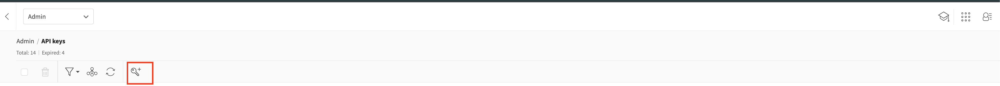

2. Read key: pick the **Team**, turn on **Read** only, set an **Expiry** and a **Purpose**, then click **Add**. Copy the key.

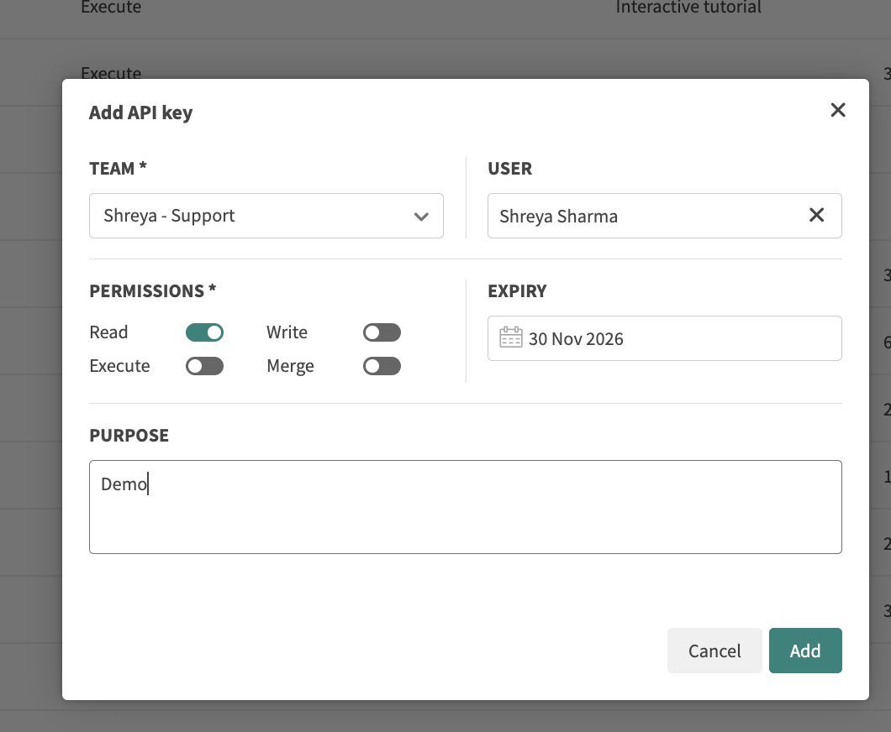

3. Write key: click the add key icon again, pick the same **Team**, turn on **Write** only, set an **Expiry** and a **Purpose**, then click **Add**. Copy the key.

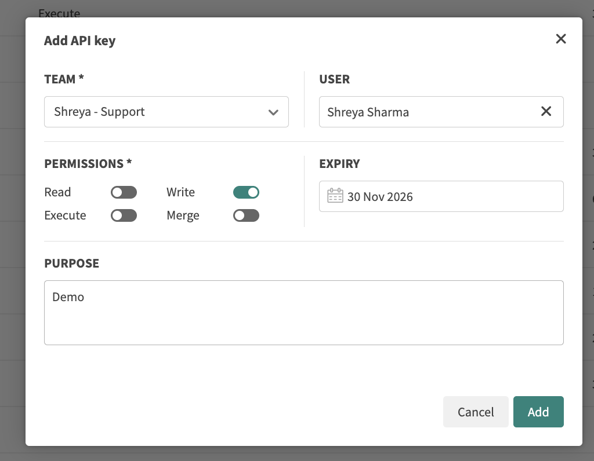

Note: when the key expires, the AI review stops working. Put a reminder before the expiry date.

---

## Step 5: Get a token for the AI agent (one-time setup)

**Requirement:** an account with the AI agent you want to use.

The agent does not have to be Claude. Any coding agent that can run in GitHub Actions and use an MCP server can do this job ( e.g. GitHub Copilot, OpenAI Codex, Gemini CLI ). In this demo I am using Claude Code, so the steps below are for Claude. With another agent, change the agent step in `implement-task.yml` and `visual-tests.yml`; the guidelines and scripts stay the same.

For Claude, run on your laptop:

```bash
npm install -g @anthropic-ai/claude-code
claude setup-token
```

Copy the token it prints. You can use an Anthropic API key (`ANTHROPIC_API_KEY`) instead.

---

## Step 6: Set up Jira and link it with GitHub (one-time setup)

**Requirement:** the Jira admin installs and configures GitHub for Atlassian.

**6.1 Create one project per product.** The key (e.g. `WIKI`) is how Jira and GitHub find each other:
tickets become WIKI-1, WIKI-2, … and branch names contain that key.

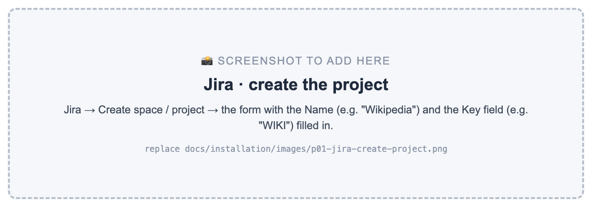

**6.2 Statuses ( must do ).** The workflow needs five statuses: New → Ready → In Progress → In Review → Done, and every new ticket must start in New. By default Jira may start new tickets in another status ( in this sample it started them in Done ), so check it:

1. Space settings → Work types → Task → **Edit workflow**.
2. Check the five statuses exist: New, Ready, In Progress, In Review, Done ( Ready: category To do ). Add a missing one with **Add status**. Delete extra ones ( e.g. Doing, To Do ).
3. Check that each status has the **Any** marker ( work items can move to it from any status ). The pipeline needs this, e.g. to move a ticket from In Review back to In Progress.
4. **The START arrow must point to New.** Click the arrow from START, and set its target status to **New** ( or drag the arrowhead onto New ).
5. Click **Update workflow**. One workflow can cover several work types ( Task, Subtask, Epic ), shown next to "Workflow for".

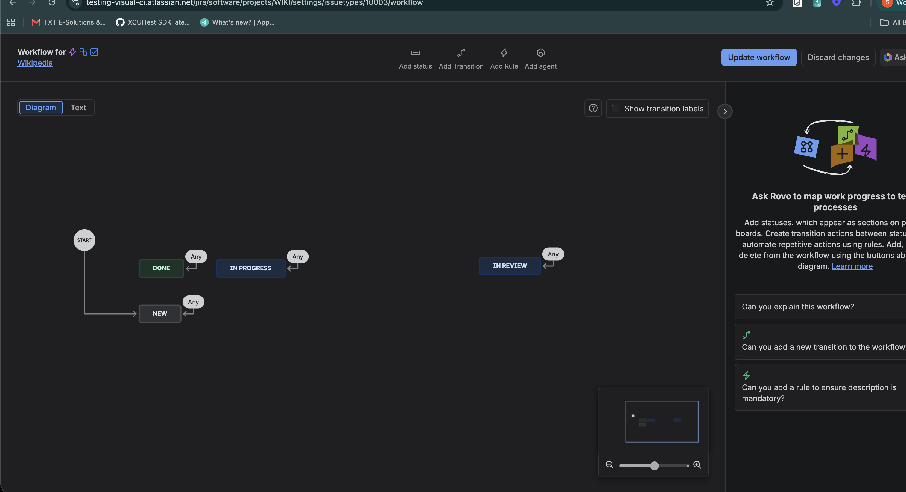

In the screenshot, START points to New and every status has the Any marker: this is the correct setup ( add Ready the same way, with Add status ).

Board: the columns should be the same five ( Board → ⋯ → Configure board → Columns ).

**6.2b Create tickets from the board ( must do ).** Create every ticket from the board: Board → **New** column → **+ Create**. The ticket appears in New straight away. The **+ Create** button at the top of Jira puts new tickets in the Backlog instead, where they don't show on the board.

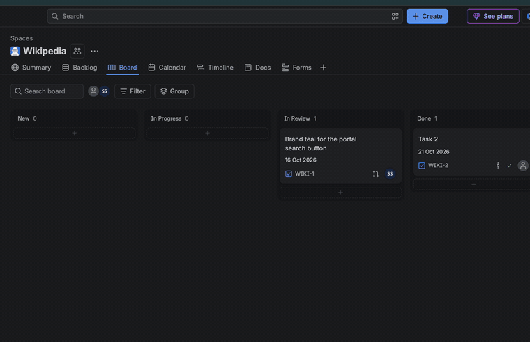

If your team uses sprints: add a Jira Automation rule that puts every new ticket in the active sprint.
1. Space settings → **Automation** → **Create rule** ( or "Create from scratch" ).
2. Trigger: **Work item created**.
3. Condition ( recommended ): **Work item fields condition** → Work type is one of **Task** ( sub-tasks follow their parent's sprint ).
4. Action: **Edit work item fields** → **Sprint** → **Active sprint** ( or "Current sprint" ), so the rule keeps working when the next sprint starts.
5. Name it "New tickets → active sprint" and turn it on.

Check: create a ticket. It should appear on the board in the New column.

**6.3 Connect GitHub.** A Jira admin installs **GitHub for Atlassian** (Jira → Apps → Explore more apps),
connects your GitHub organisation and selects your repository. Branches, commits and pull requests then
appear on each ticket under **Development**.

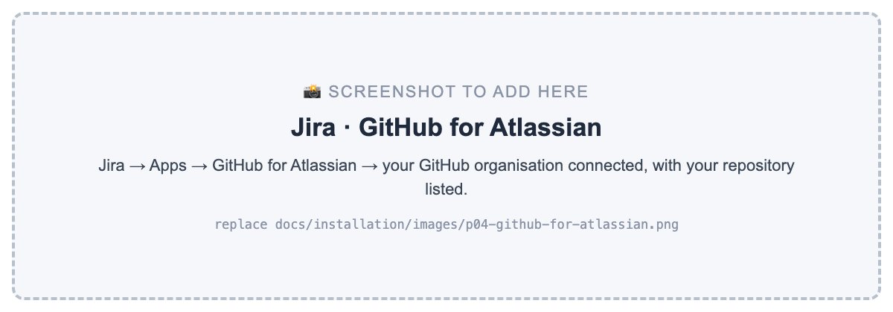

**6.4 Create an API token** for the pipeline at
[id.atlassian.com → Security → API tokens](https://id.atlassian.com/manage-profile/security/api-tokens).
Use a service account if you have one, not a personal login.

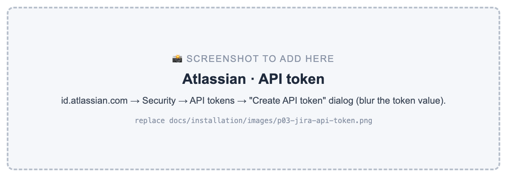

---

## Step 7: Create the AI's GitHub account, a GitHub App (one-time setup)

**Requirement:** the owner of the GitHub account or organisation.

The AI works with its own GitHub account. This way its pull requests are checked the same way as a developer's, and everything it does is visible.

1. Go to **github.com/settings/apps/new**, or your organisation's Settings → Developer settings → GitHub Apps.
2. Name: e.g. `Eyes MCP Visual Agent`. On pull requests it appears as `eyes-mcp-visual-agent[bot]`.
3. Homepage URL: your repository's URL.
4. Webhook: untick Active.
5. Repository permissions: set Contents, Pull requests, Issues and **Workflows** to Read and write. Workflows is needed when Agent 1 brings an old branch up to date with `main` and `main` has a newer pipeline.
   Leave everything else as it is.
6. Where can this app be installed: Only on this account.
7. Click **Create GitHub App**. Copy the **App ID**, then click **Generate a private key**. A `.pem` file downloads.
8. Click **Install App** → **Only select repositories** → choose your repository.

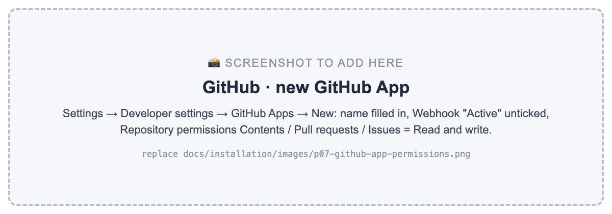

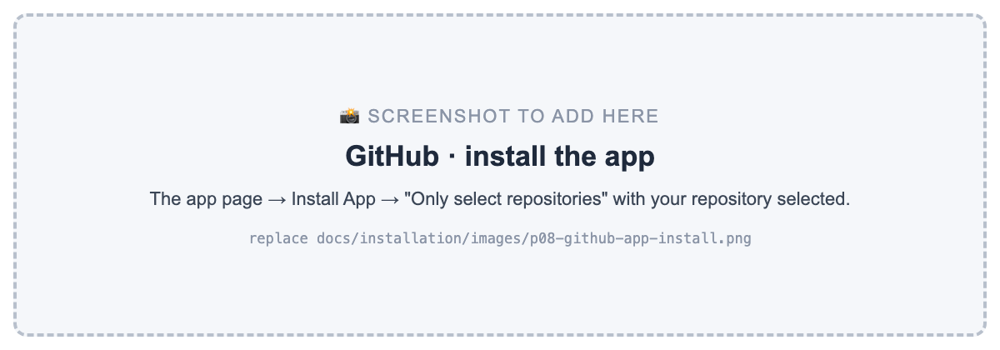

---

## Step 8: Add secrets and variables to the repository (one-time setup)

**Requirement:** a repository admin.

Go to your repository → **Settings → Secrets and variables → Actions**.

**Secrets** tab (values are hidden once saved):

| Secret | Value |
|---|---|
| `APPLITOOLS_API_KEY` | Applitools API key (Step 4) |
| `APPLITOOLS_READ_KEY` | Applitools read key (Step 4) |
| `APPLITOOLS_WRITE_KEY` | Applitools write key (Step 4) |
| `CLAUDE_CODE_OAUTH_TOKEN` | Claude token (Step 5), or set `ANTHROPIC_API_KEY` instead |
| `JIRA_BASE_URL` | `https://<your-site>.atlassian.net` |
| `JIRA_EMAIL` | The email of the Jira account that owns the API token |
| `JIRA_API_TOKEN` | The Jira API token (Step 6.4) |
| `BOT_APP_PRIVATE_KEY` | The whole content of the `.pem` file (Step 7). Delete the file afterwards |

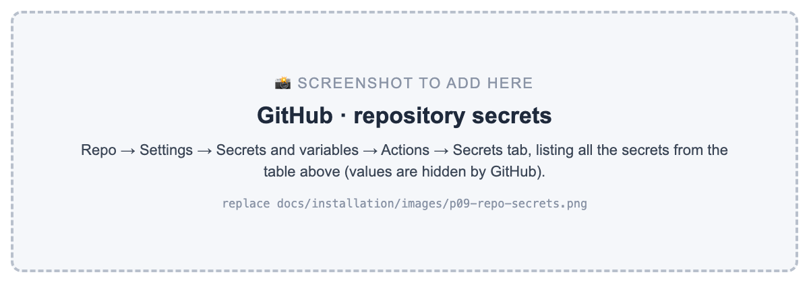

**Variables** tab:

| Variable | Value |
|---|---|
| `BOT_APP_ID` | The App ID (Step 7) |
| `APP_START_COMMAND` | How to start your app (Step 2) |
| `APP_URL` | Where your app runs in CI (Step 2) |
| `AGENT_ALLOWED_PATHS` | Folders Agent 1 may change (Step 2) |
| `NO_TICKET_PATHS` | Optional: paths that need no Jira ticket ( default `docs/ .github/ visual-agent/ README.md` ) |
| `MERGE_POLICY` | `code-approval` ( default: one person approves the PR ) or `auto` ( merge when the AI review passes ). The Jira label `auto-ai-merge` always merges automatically |

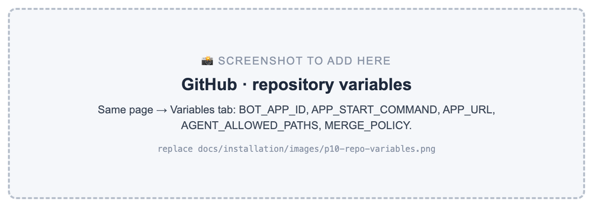

---

## Step 9: Protect `main` (one-time setup)

**Requirement:** a repository admin.

Note: rulesets on a **private** repository need GitHub Pro, Team or Enterprise. On GitHub Free, they only work on public repositories.

Go to your repository → **Settings → Rules → Rulesets → New branch ruleset**:

| Setting | Value |
|---|---|
| Name | `Protect main` |
| Enforcement | Active |
| Target branches | Default branch |
| Bypass list | Your GitHub App (Always). Repository admin (For pull requests only) |
| Rules | Restrict deletions · Block force pushes · **Require a pull request before merging** · **Require status checks to pass:** `Branch links to a Jira ticket` and `Visual review` |

From now on every change goes through a pull request. A PR without a valid Jira ticket, or with a failed review, cannot be merged. A PR that only changes docs or the pipeline ( `NO_TICKET_PATHS` ) needs no ticket: both checks pass straight away.

Why the GitHub App is on the bypass list: with the label `auto-ai-merge`, the pipeline merges by itself. It uses the bypass only after both required checks have passed; it skips only the approval. Without that label, a person still approves every pull request.

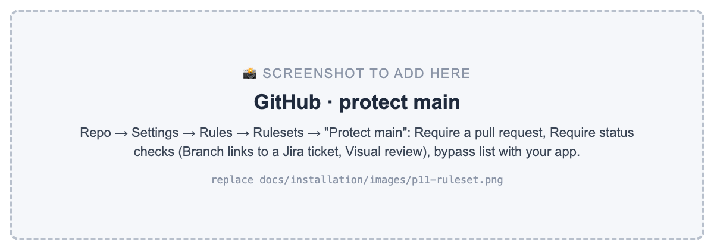

---

## Step 10: Add the custom agent button ( Agent 1 ) in Jira (one-time setup)

**Requirement:** a Jira project admin, and a GitHub token that can start workflows.

**10.1 A GitHub token for Jira.** Go to
[github.com/settings/personal-access-tokens/new](https://github.com/settings/personal-access-tokens/new):
- **Repository access:** only your repository.
- **Permissions:** **Actions: Read and write**. Nothing else.

**10.2 The rule.** Click order in Jira:

1. Your Jira space → **Space settings → Automation → Create rule** → **Create from scratch**.
2. **Add a trigger** → search **Manual trigger** → select it → Save.
3. **Add component** → **THEN: Add an action** → search **Send web request** → fill in the fields below.
4. Optional: **Add component** → **IF: Add a condition** → **Status is not Done**.
5. **Save and enable**, and name the rule **Agent 1**.

The fields:

| Field | Value |
|---|---|
| Trigger | **Manual trigger** (from a work item) |
| Action | **Send web request** |
| URL | `https://api.github.com/repos/<owner>/<repo>/actions/workflows/implement-task.yml/dispatches` ( for this sample: `https://api.github.com/repos/ssharma007-dev/wikipedia-visual-ci/actions/workflows/implement-task.yml/dispatches` ) |
| Method | `POST` |
| Body | Custom data: `{"ref":"main","inputs":{"key":"{{issue.key}}"}}` |
| Headers | `Authorization` = `Bearer <token from 10.1>` (tick **Hidden**) · `Accept` = `application/vnd.github+json` · `Content-Type` = `application/json` |
| Delay execution of subsequent flow actions until we've received a response | Ticked ( the rule's Audit log then shows `204` when it worked ) |

The name **Agent 1** is what people see in the ticket's ⚡ ( Automation ) menu. The condition **Status is not Done** keeps the button from being used on finished tickets.

Check: open a ticket in Ready → ⚡ → **Agent 1**. Within a few seconds a run "Agent 1 — implement task" appears in GitHub → Actions. If not, open the rule's **Audit log**: `401` / `403` = the token or its permission, `404` = a typo in the URL.

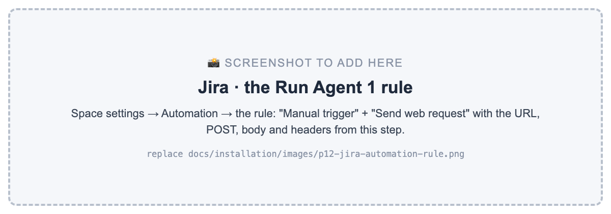

---

## Step 11: Create the first baseline (one-time setup)

Go to **Actions → Visual tests → Run workflow** on `main`. The first run saves every screen as the baseline
in Eyes. Every later change is compared with it.

---

## Step 12: Use it, every day

A ticket can be implemented in two ways: (1) the AI agent builds it, [ or ] (2) a developer builds it.

### (1) The AI agent builds it

**1. The product manager creates the ticket** ( New ) with two lists: *what should change* and *what must not change*. The team lead or dev manager reviews it and moves it to **Ready**.
Optional labels: `bug`, `hotfix`, `text`, `human-review`, `auto-ai-merge`, `tests-only`.

**2. In Ready, the team lead or dev manager ( or anyone ) clicks the ⚡ ( Automation ) button → Agent 1** on the ticket. It moves to **In Progress**.

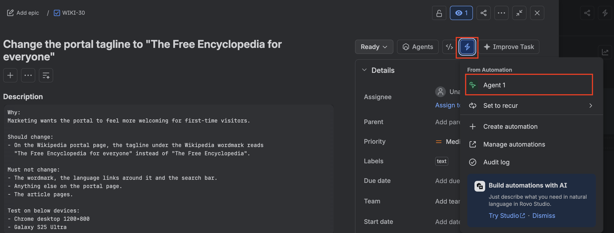

**3. Agent 1 works in GitHub Actions.** It creates the branch, builds the change, writes the tests, runs
them in Eyes and reviews every difference with the Eyes MCP. If it caused a bug, it fixes it and tests again.


**4. The pull request is opened by the AI's account,** with a summary of what changed:

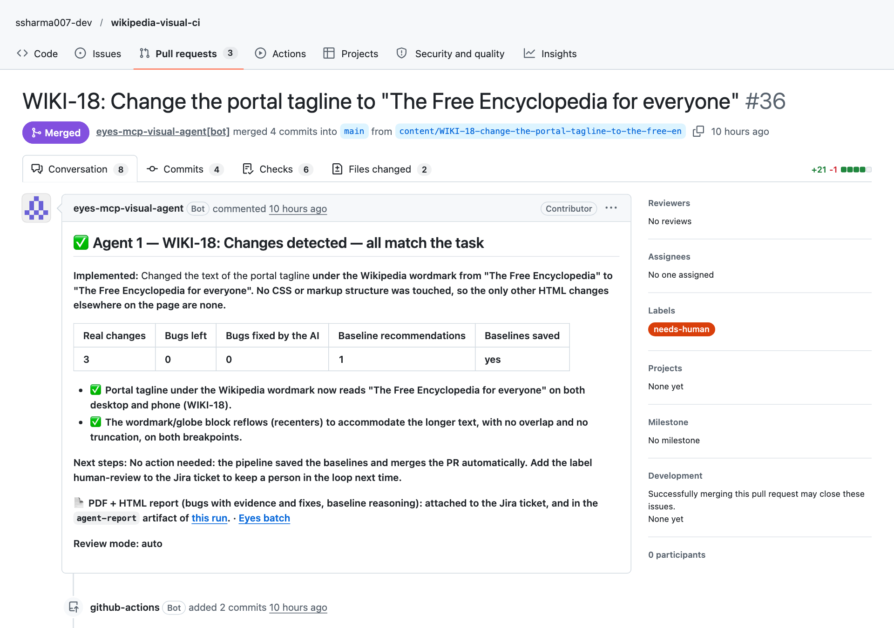

**5. The checks run on the PR.** The Ticket check confirms which Jira ticket it belongs to:

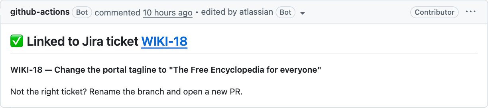

**6. The PDF report** is attached to the Jira ticket and linked on the PR:

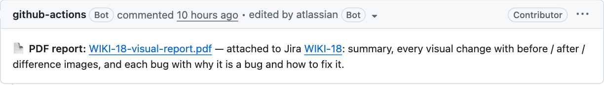

It contains the summary, each bug with why it's a bug and how to fix it, and before / after / difference
images for every change:

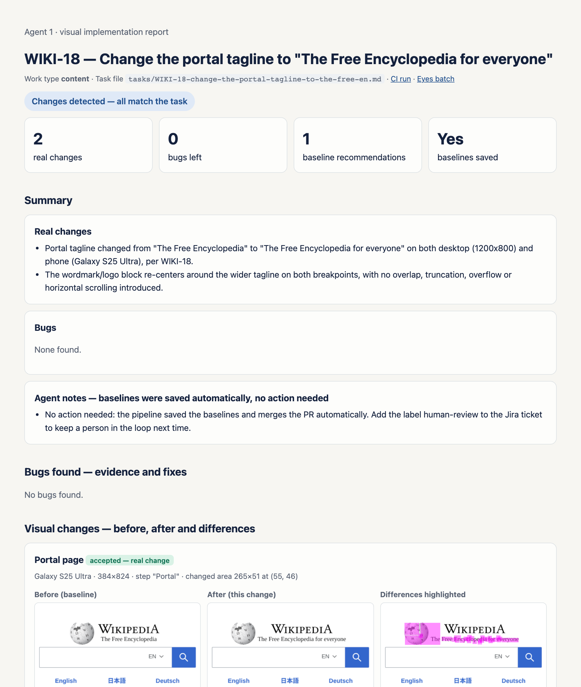

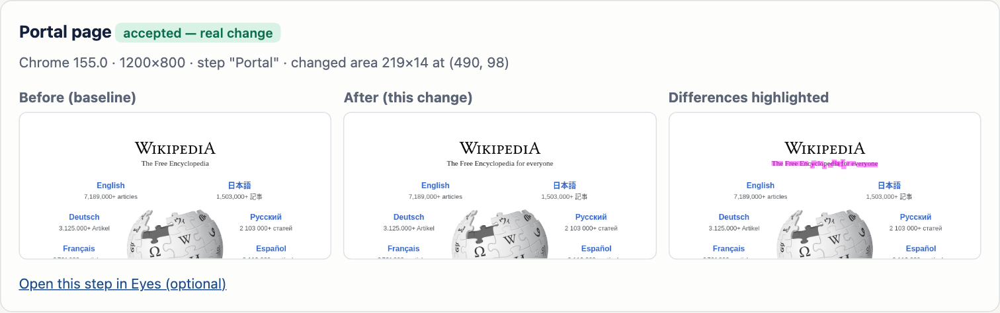

**7. The decision:**
- No bugs found: the baselines are saved. By default a person approves the PR ( one click ), then GitHub merges it and the ticket moves to Done. With the `auto-ai-merge` label, the pipeline merges it by itself.
- Bugs the AI cannot fix, or the `human-review` label: the PR and the ticket get the label `needs-human`, the ticket moves to In Review and is assigned to the person who created it, and the PR is blocked.

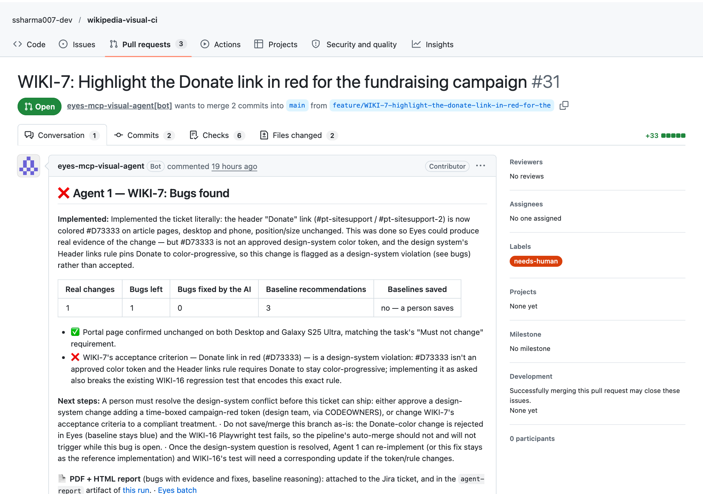

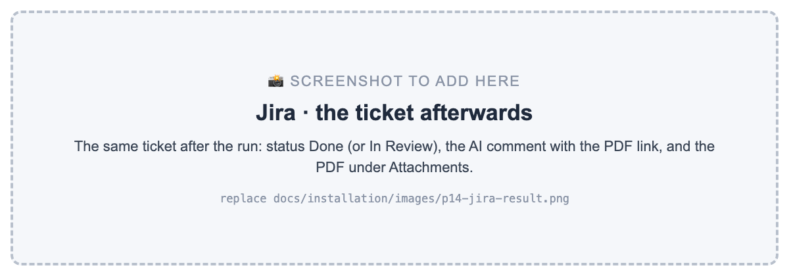

### (2) A developer builds it

1. Create the branch from the ticket: (1) in Jira, **Development → Create branch** [ or ] (2) in git, with the
   ticket key in its name, e.g. `feature/WIKI-17-make-donate-bold`. Either way it is linked to the ticket.
2. Make the change and push.
3. Add the test cases: (1) in your IDE with the Eyes MCP Server ( Step 13 ) [ or ] (2) add the label `tests-only` to the ticket and click ⚡ Run Agent 1. The AI writes and runs the tests on your branch and never changes your code; then `git pull`.
4. Open a pull request. The same checks, AI review, PDF and decision happen automatically. The AI reports bugs but never
   changes a developer's code.

---

## Step 13: Use the Eyes MCP Server in your IDE (optional, for developers)

**Requirement:** a developer with Applitools keys ( Step 4 ) and an AI assistant in the IDE ( Claude Code, GitHub Copilot in VS Code, or Cursor ).

Developers can write and check the test cases on their laptop, before pushing, with the same Eyes MCP Server and the same rules as the AI agent. This is the fastest way: write the test, run it, and see the Eyes result in minutes.

1. Set your keys in the terminal ( don't commit them ):

```bash
export APPLITOOLS_API_KEY=<your API key>
export APPLITOOLS_READ_KEY=<read key>
export APPLITOOLS_WRITE_KEY=<write key>
```

2. Connect the Eyes MCP Server to your IDE. It is the same server as in `visual-agent/mcp.json`:
- (1) Claude Code: copy `visual-agent/mcp.json` to `.mcp.json` in the repository root, then start `claude` in that folder.
- (2) Cursor: copy `visual-agent/mcp.json` to `.cursor/mcp.json`.
- (3) VS Code with GitHub Copilot: create `.vscode/mcp.json` with the same content, but rename `mcpServers` to `servers`.

3. Start the app ( `npm start` ) and ask the AI, for example:

```
Read tasks/WIKI-17-*.md and visual-agent/guidelines/agent-implement.md.
Write the Playwright + Eyes test cases for this ticket, run them,
and review the results with the Eyes MCP Server.
```

4. Push. The pipeline runs the same tests and the AI review on the pull request, so nothing is skipped.

No IDE setup? Use the label `tests-only` and ⚡ Run Agent 1 instead ( Step 12 ).

---

## Settings you can change later

| What | How |
|---|---|
| A person must approve this ticket | Add the label `human-review` to the Jira ticket |
| Merge a ticket without waiting for approval | Add the label `auto-ai-merge` to the Jira ticket |
| Merge everything without approval ( repository-wide ) | `visual-agent/scripts/set-merge-policy.sh auto` ( back with `code-approval`, the default ) |
| How strict the AI is | Edit `visual-agent/guidelines/review-rules.md` |
| Your design rules | Edit `visual-agent/guidelines/design-system.md` |
| Browsers and devices | `browsersInfo` in `playwright.config.ts` |
| How often people agree with the AI | **Actions → Trust report → Run workflow** |

---

## Troubleshooting

| You see | Meaning | Fix |
|---|---|---|
| ❌ *No Jira ticket found* on the PR | The branch name has no key, or the key doesn't exist | Rename the branch: `git branch -m feature/WIKI-17-…`, push, and open a new PR |
| Clicking Run Agent 1 does nothing | The Jira rule's request failed | Jira rule → **Audit log**: `401`/`403` = token or its permission, `404` = URL typo |
| *Site did not start* in the run | `APP_START_COMMAND` or `APP_URL` is wrong | Run the command locally and open the URL |
| *AI visual review paused: usage limit* | The Claude usage limit was reached | Re-run later: Actions → the run → Re-run jobs |
| *The PDF was NOT attached* warning | The Jira token can't add attachments | Check the `JIRA_*` secrets; the PDF is also in the run's artifacts |
| The agent's PR doesn't get checks | The GitHub App isn't installed on the repository | Step 7.8, and `BOT_APP_ID` / `BOT_APP_PRIVATE_KEY` in Step 8 |
| *Functional checks failed* | A Playwright `expect` failed | Fix the code or update the test. The PDF lists the failed checks |

---

## Reference

- Applitools Eyes MCP Server: https://applitools.com/docs/eyes/integrations/mcp-servers/applitools-mcp
- Reviewing test results in Eyes: https://applitools.com/docs/eyes/concepts/reviewing-tests/test-maintenance
- Playwright with Applitools Eyes: https://applitools.com/tutorials/playwright
- Ultrafast Grid browsers and devices: https://applitools.com/docs/eyes/concepts/test-execution/ultrafast-grid-devices-browsers
- GitHub for Atlassian: https://support.atlassian.com/jira-cloud-administration/docs/integrate-with-github/
- GitHub rulesets: https://docs.github.com/repositories/configuring-branches-and-merges-in-your-repository/managing-rulesets
